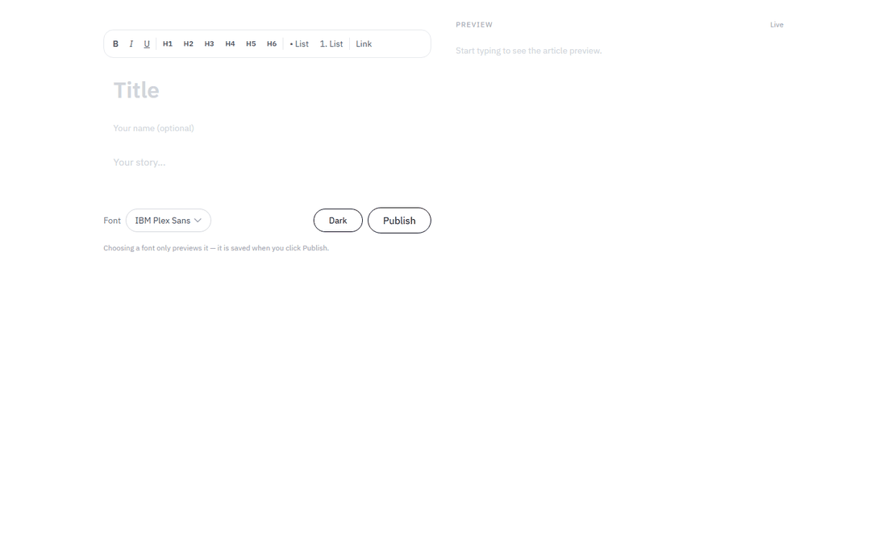
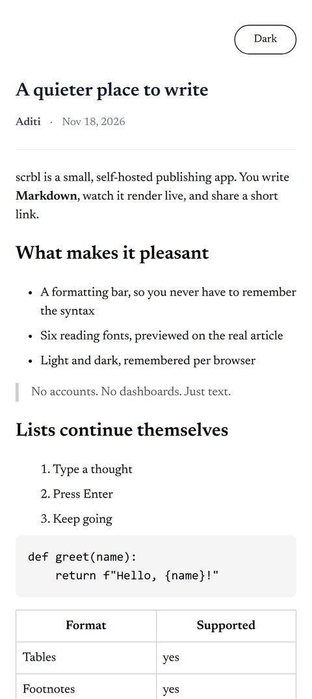

# scrbl

**A quiet place to write.** scrbl is a small, self-hosted publishing app: write Markdown, watch it render live, and share a short link. No accounts, no dashboards, no build step — just text.

[](LICENSE)
[](https://www.djangoproject.com/)
[](Dockerfile)



## Why scrbl

- **Write, don't configure.** Markdown with a live rendered preview beside it.
- **Formatting without syntax.** A toolbar for bold, italic, underline, headings, lists and links — plus lists that continue themselves when you press Enter.
- **Type that suits the piece.** Six reading fonts, previewed on the real article before you commit.
- **Readable anywhere.** Long titles, URLs, code and tables wrap instead of forcing sideways scrolling on a phone.
- **Light or dark**, remembered per browser, including the comments panel.
- **No account for readers.** Publishing a note gives you a short link and a private edit token.

<p align="center">
  
  <br><sub>Notes read comfortably on a phone — nothing scrolls sideways.</sub>
</p>

## Quick start

```bash
git clone https://github.com/driftywinds/scrbl.git
cd scrbl
./setup.sh
```

Open <http://localhost:9009>. On first run scrbl asks you to create the administrator account.

`setup.sh` creates a `.env` with local defaults and runs Docker Compose. If you would rather do it by hand:

```bash
cp .env.example .env    # set SECRET_KEY, ALLOWED_HOSTS, CSRF_TRUSTED_ORIGINS
docker compose up -d --build
```

### Without Docker

```bash
python -m venv .venv && . .venv/bin/activate
pip install -r requirements.txt
python manage.py migrate
python manage.py runserver
```

## Configuration

Environment variables (`.env` is read by Compose; Docker and systemd need them set directly):

| Variable | Default | Purpose |
| --- | --- | --- |
| `SECRET_KEY` | insecure dev key | **Set this in production.** |
| `DEBUG` | `True` | Set `False` in production. |
| `ALLOWED_HOSTS` | `*` | Comma-separated hostnames. |
| `CSRF_TRUSTED_ORIGINS` | empty | Comma-separated origins, e.g. `https://scrbl.example.com`. |
| `ENABLE_COMMENTS` | `True` | `False` turns off the ParaNote comment layer entirely. |
| `TIME_ZONE` | `UTC` | IANA name for admin and dated output, e.g. `Asia/Kolkata`. |
| `DATABASE_URL` | local `db.sqlite3` | Any `dj-database-url` URL; the Docker image uses `/data/db.sqlite3`. |
| `PORT` | `9009` | Host port published by Compose. |

## Using scrbl

1. **Write.** Title, optional byline, then Markdown. The right-hand pane renders as you type.
2. **Format.** Select text and use the toolbar, or type Markdown yourself. `1.` and `-` lists continue on Enter; Enter on an empty item ends the list.
3. **Choose a font.** The preview updates immediately; the choice is saved when you publish.
4. **Publish.** You are redirected to the note, and the browser stores a private edit token.
5. **Edit or delete.** The note shows **Edit** and **Delete** while you hold the token. **Backup Edit Link** copies a URL that restores access on another device.
6. **Share.** Readers get a clean page with no controls — only a theme switch.

### Supported Markdown

Headings, lists, links, images, blockquotes, fenced code, tables, footnotes, `~~strikethrough~~`, and inline HTML such as `<u>underline</u>`. Bare YouTube links become embeds.

## Fonts

| Font | Source |
| --- | --- |
| IBM Plex Sans (default) | Google Fonts |
| Source Sans 3 | Google Fonts |
| **Allo** | bundled |
| Newsreader | Google Fonts |
| Source Serif 4 | Google Fonts |
| EB Garamond | Google Fonts |

[Allo](https://github.com/joshpuckett/allo) isn't on Google Fonts, so its web fonts ship with scrbl under `static/fonts/allo/` (SIL Open Font License). Update it with:

```bash
python scripts/update_allo.py          # fetch the latest release and verify its checksums
python scripts/update_allo.py --check  # report only; exits 1 when an update exists
```

Then bump the `?v=` on `css/styles.css` in `templates/tapnote/base.html` and rebuild.

## Comments

Comments are paragraph-level, powered by [ParaNote](https://github.com/zoidberg-xgd/paranote):

- click a paragraph to read or add comments
- replies, likes, and re-anchoring that keeps comments on the right paragraph after edits
- note authors and admins can delete comments; admins can ban readers
- disable the whole layer with `ENABLE_COMMENTS=False`

## Data and backups

- **Migration page** (`/migration/`, staff only): export every note as JSON, or import a previous export.
- The Docker image keeps the database in the `scrbl-data` volume and uploads in `scrbl-media`.
- `scripts/txt2tapnote.py` bulk-imports text files as notes.

## Deployment

### Docker Compose

```yaml
services:
  scrbl:
    image: ghcr.io/driftywinds/scrbl:latest
    restart: unless-stopped
    environment:
      TIME_ZONE: Asia/Kolkata
    ports:
      - "9009:9009"
    env_file: .env
    volumes:
      - ./data:/data
      - ./media:/app/media
```

Compose changes only take effect after `docker compose up -d --force-recreate`; use `--build` when you changed the source.

### PythonAnywhere

`deploy_pa.sh`, `scripts/renew_pa.py`, `DEPLOY_PYTHONANYWHERE.md` and `UPDATE_PYTHONANYWHERE.md` cover deployment and renewing a free web app.

## Development

```bash
python manage.py test          # full suite
./run_tests.sh --coverage      # with coverage
node --check static/js/editor.js
```

There is no frontend build step: Tailwind and Google Fonts load from CDNs, and Django serves the static files (WhiteNoise in production).

```
tapnote/      Django app: models, views, Markdown pipeline, font choices
prototype/    project settings and URLs
templates/    editor, note, setup and migration pages
static/       CSS, JS, and the bundled Allo webfonts
scripts/      maintenance scripts (font update, renewal, txt import)
```

Adding a font means an entry in `tapnote/fonts.py` (and a migration for `Note.font`); if it isn't on Google Fonts, add its `@font-face` to `static/css/styles.css` and leave `google_family` empty.

## Limitations

- Notes are capped at 200,000 characters.
- One SQLite database per instance; no multi-tenant accounts.
- Edit access is a bearer token — anyone with the link can edit until it is deleted.

## License

[MIT](LICENSE).

## Thanks

- Inspired by [Telegra.ph](https://telegra.ph)
- Started from concepts in [vorniches/tapnote](https://github.com/vorniches/tapnote)
- Built with [Django](https://www.djangoproject.com/) and [Tailwind CSS](https://tailwindcss.com/)
- Comments by [ParaNote](https://github.com/zoidberg-xgd/paranote)
- Allo typeface by [Josh Puckett](https://github.com/joshpuckett/allo), SIL Open Font License
